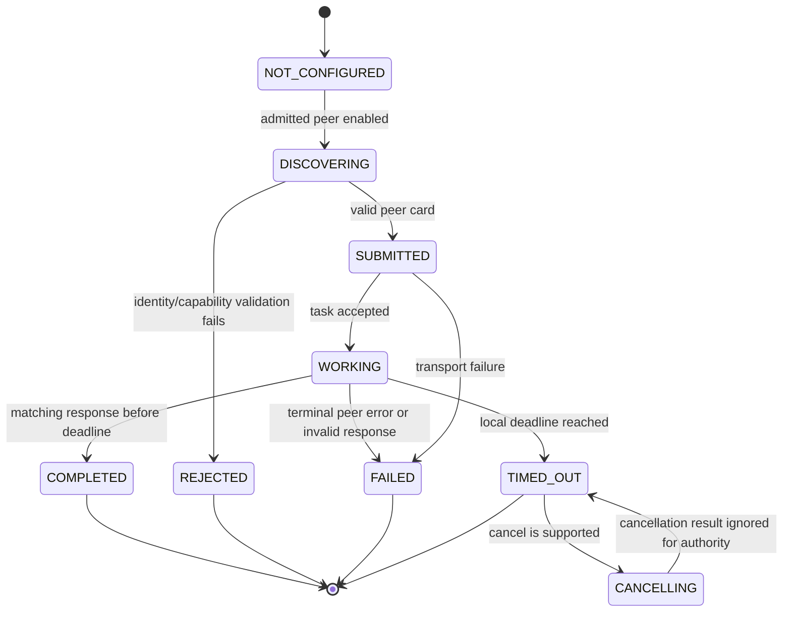

# Hermes Peer Messaging Contract

**Status:** Proposed design for [issue #6](https://github.com/Vidanez/openjarvis_with_breaks/issues/6). This page defines a target contract; it does not describe an implemented integration.

## Decision

OpenJarvis may consult a separately operated Hermes instance as an **independent peer** through a small, allowlisted A2A-based peer protocol. Hermes is not an OpenJarvis agent, plugin, tool host, current profile, credential store, or subprocess imported into the OpenJarvis process.

The peer boundary is advisory by default. A Hermes response can contain analysis, a recommendation, or a structured proposal, but it cannot invoke an OpenJarvis tool, create an approval, or cause an external effect. OpenJarvis alone owns approval, execution, credentials, audit records, and all provider-facing mutations.

This is optional: when no admitted peer is configured or the peer is unavailable, OpenJarvis continues its local workflow and reports the peer as unavailable rather than weakening a policy or substituting a result.

## Scope and non-goals

| In scope | Explicitly out of scope |
| --- | --- |
| A bounded peer identity and discovery contract | Installing a Hermes plugin or extension |
| Correlated advisory requests and responses | Accessing Hermes's current or active profile |
| Timeouts, failure states, and audit-safe metadata | Sharing credentials, refresh tokens, cookies, or API keys |
| Separating proposals from owner-approved effects | Production deployment or network setup |
| A2A versus MCP selection for peer messaging | Giving inbound email, attachments, links, or messages authority |

## Trust and ownership boundary

### Independent peer invariant

The Hermes peer MUST run as a separately configured instance with its own state, configuration, and credential boundary. OpenJarvis identifies it only through an admitted peer record; it MUST NOT discover, mount, read, or select Hermes profiles, workspaces, browser sessions, vaults, or local configuration directories.

An admitted peer record is an OpenJarvis-owned configuration object containing only non-secret identity and transport references:

```json
{
  "peer_id": "hermes:research-peer:01",
  "display_name": "Hermes research peer",
  "protocol": "a2a",
  "endpoint": "https://peer.example.invalid/a2a",
  "expected_card_id": "hermes:research-peer:01",
  "expected_protocol_version": "ojh-peer/v1",
  "allowed_message_types": ["advice.request", "proposal.request"],
  "max_timeout_seconds": 30,
  "enabled": false
}
```

The example endpoint is illustrative only. Endpoint admission, transport authentication material, and any certificate or key reference are deployment-owned and remain outside this contract. A peer identity is accepted only when the discovered card and authenticated transport identity match the locally admitted record. A mutable display name, URL redirect, self-asserted capability, or message field is not identity proof.

### Untrusted input rule

Every peer payload, like every email, attachment, document, link, channel message, and model output, is untrusted data. It may contribute content to a bounded request or response after validation, but it MUST NOT:

- select a peer, protocol, capability, or tool;
- create or satisfy owner approval;
- create recipients, attachments, destinations, credentials, or permissions;
- make OpenJarvis call an external tool or provider; or
- override configured limits, policies, or the admitted peer record.

OpenJarvis records only minimum operational metadata by default. Raw peer content follows the same local retention and redaction policy as other untrusted input; secrets and credentials are never included in peer messages or audit previews.

## Protocol selection: A2A for the peer, MCP for tools

| Criterion | A2A | MCP | Decision for Hermes peer messaging |
| --- | --- | --- | --- |
| Primary model | Agent-to-agent task exchange | Host invokes a server's tools/resources/prompts | Peer relationship favors A2A |
| Long-running work and task state | Native task lifecycle and polling/cancel shape | Tool-call lifecycle; host owns the call | A2A maps to bounded consultation |
| Peer identity and capability card | Agent card discovery is a natural extension point | Server/tool discovery identifies callable capabilities, not a peer collaborator | A2A supports an admitted peer card |
| Conversation/request correlation | Task and JSON-RPC IDs can be bound to a local correlation ID | Tool-call IDs correlate an invocation, but do not define a peer conversation contract | A2A is clearer after adding the envelope below |
| Authority risk | Can be restricted to advisory task types | Imported MCP tools become callable OpenJarvis capabilities | Do not expose Hermes as an MCP tool server for this use case |
| Existing OpenJarvis support | Existing A2A client, agent card, task states, polling, and cancel primitives | Existing MCP loader imports remote tools into `ToolExecutor` | Extend A2A; do not repurpose MCP |

MCP remains appropriate when OpenJarvis deliberately adopts a narrowly scoped external capability as a tool and can enforce its tool policy. That is the wrong default for independent peer consultation: it turns a remote service into a callable tool surface and blurs advice with effects. The selected architecture uses A2A transport plus the application envelope below; it does not claim that the current A2A implementation already enforces this contract.

## Peer card and admission

Before a request, OpenJarvis fetches the A2A agent card from the configured endpoint and validates it against the admitted record. The peer card MUST expose:

| Field | Requirement |
| --- | --- |
| `peer_id` | Stable opaque identifier; exactly equals `expected_card_id` |
| `protocol_versions` | Includes `ojh-peer/v1` |
| `message_types` | Subset of the locally allowed message types |
| `effect_capability` | Always `false` for this contract |
| `authentication` | Describes the configured transport mechanism without publishing credentials |
| `limits` | Maximum accepted input bytes and supported deadline range |

Discovery does not grant authority. Any mismatch, missing field, redirect, unexpected capability, or authentication failure rejects the peer for that request and produces a local `peer_unavailable` outcome.

## Message contract

All requests and responses use an A2A task message whose application payload is a versioned JSON object. Unknown fields are ignored only after schema validation; unknown `message_type`, protocol version, or enum value is rejected. Text is bounded by bytes and item counts before it is sent or retained.

### Common envelope

```json
{
  "protocol_version": "ojh-peer/v1",
  "message_id": "msg_01J...",
  "message_type": "advice.request",
  "sent_at": "2026-11-12T10:00:00Z",
  "peer_id": "hermes:research-peer:01",
  "correlation_id": "corr_01J...",
  "causation_id": "local_event_01J...",
  "deadline_at": "2026-11-12T10:00:30Z",
  "payload": {}
}
```

- `message_id` is unique per transmitted envelope and is never reused after retry.
- `correlation_id` is generated by OpenJarvis and is stable across the one logical consultation, its polling, cancellation, and terminal audit record.
- `causation_id` points to the local request or event that prompted the consultation; it is metadata only and confers no authority.
- `peer_id` must equal the admitted peer record on requests and responses.
- `deadline_at` is set by OpenJarvis, never extended by the peer, and must be within the locally configured maximum timeout.

OpenJarvis binds its `correlation_id` to the A2A JSON-RPC request ID and persists the returned A2A task ID as transport metadata. A response is accepted only if its `peer_id`, `correlation_id`, task ID, and request/response message types match the outstanding local record.

### Allowed message types

| Type | Direction | Required payload | Meaning |
| --- | --- | --- | --- |
| `advice.request` | OpenJarvis → Hermes | `question`, bounded `context`, `constraints` | Request analysis or recommendation only |
| `advice.response` | Hermes → OpenJarvis | `answer`, `assumptions`, `confidence`, `sources` | Non-binding answer with provenance references where available |
| `proposal.request` | OpenJarvis → Hermes | `objective`, `constraints`, `allowed_output_schema` | Request a proposed plan or draft, not execution |
| `proposal.response` | Hermes → OpenJarvis | `proposal`, `assumptions`, `risk_flags` | Structured candidate for local validation and owner review |
| `status` | Either direction | `state`, optional `retry_after_seconds` | Informational progress; cannot alter deadline or policy |
| `error` | Either direction | `code`, safe `message`, `retryable` | Terminal or diagnostic protocol outcome |

No message type represents `tool.call`, `tool.result`, credential transfer, profile selection, approval, execution request, or execution receipt. The peer's output is content, not an instruction to OpenJarvis.

## Lifecycle, deadline, and failures



| Condition | OpenJarvis behavior | Retry rule |
| --- | --- | --- |
| No enabled admitted peer | Skip consultation; continue local flow | No automatic configuration or discovery |
| Discovery/authentication/card mismatch | Mark `rejected`; retain safe reason | No retry until configuration changes |
| Connection failure before task acceptance | Mark `failed` | At most one retry only when the operation is idempotent and still before deadline |
| HTTP/A2A timeout or no terminal result by deadline | Mark `timed_out`; optionally send cancellation | Never use a late result automatically |
| Peer returns an `error` | Mark `failed` with redacted code/message | Retry only if `retryable=true`, idempotent, and budget remains |
| Malformed, oversized, mismatched, or unsupported response | Mark `failed` and quarantine payload | No retry of the same response |
| Late response after terminal timeout/failure | Store only if policy permits; label `late_untrusted` | It cannot resume, approve, or execute anything |

The deadline is an end-to-end local budget, not a sequence of independent transport timeouts. Discovery, submission, polling, and cancellation all consume the same budget. A peer may report progress, but OpenJarvis determines the terminal state. No failure mode authorizes a fallback external action.

## Advice, proposals, and external effects

The contract deliberately has three different objects and state machines:

| Object | Created by | Permitted content | Authority |
| --- | --- | --- | --- |
| Advice | Hermes or OpenJarvis | Analysis, recommendations, cited sources, uncertainty | None; display or use as untrusted context |
| Proposal | Hermes or OpenJarvis | Bounded draft/plan matching a local schema | None; must pass local validation and owner review |
| Approval object | OpenJarvis after authenticated owner action | Exact rendered effect, targets, attachment/version references, expiry, nonce, idempotency key | Single-use permission for the named effect only |

An external effect includes sending a message, creating/modifying/deleting a remote record, purchasing/ordering, granting access, exporting data, executing code outside the approved local boundary, or dispatching any provider action. These effects require an OpenJarvis-owned immutable approval object and a fresh re-read of mutable remote state before execution. Hermes cannot create, modify, approve, consume, or receive that object.

Incoming mail, attachments, documents, links, peer responses, and model-generated text can propose an effect but cannot become an approval or select its targets. In particular, a message such as "send this now" remains untrusted content until the owner explicitly confirms the exact locally rendered payload in OpenJarvis.

## Validation and audit requirements

Before accepting an integration implementation, tests must prove all of the following:

1. An unconfigured or disabled peer is never contacted.
2. A valid endpoint with the wrong peer ID, card ID, protocol version, or capability is rejected.
3. Request and response correlation rejects a task ID, JSON-RPC ID, or `correlation_id` from another request.
4. Timeout is terminal locally; a delayed response cannot cause an effect.
5. Malformed, oversized, or unknown message types fail closed without invoking a tool.
6. `advice.response` and `proposal.response` cannot reach an execution path without an OpenJarvis-generated approval object.
7. Email/attachment/link content and peer output cannot create recipients, targets, credentials, capability selection, or approval.
8. Logs/audit records contain peer ID, correlation ID, state transition, safe failure code, and timing, but not credentials or raw secret-bearing payloads.

## Implementation boundary

This document is intentionally design-only. It proposes a versioned application envelope over OpenJarvis's existing A2A primitives, which currently expose agent-card discovery, task submission, polling, cancellation, JSON-RPC request IDs, and task states. The implementation must add admission validation, schema validation, identity binding, correlation persistence, deadline accounting, safe audit events, and the strict separation between peer outputs and OpenJarvis approval/execution.

No code, plugin installation, current-profile integration, credential exchange, endpoint provisioning, or production deployment is authorized by this design.
